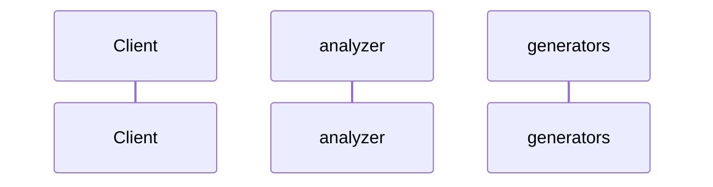

# Automated Architecture Documentation

Generated by `autodocs`. Scanned 4 source files.

## Data model

```mermaid
erDiagram
```

## Service interactions



## Discovered services

- **analyzer**: no public methods detected
- **generators**: no public methods detected
